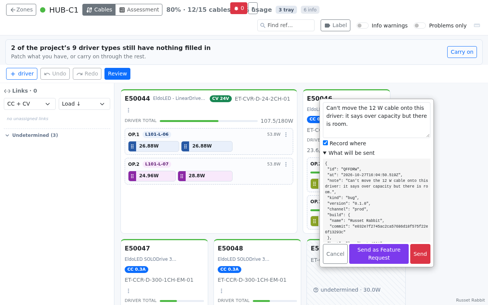
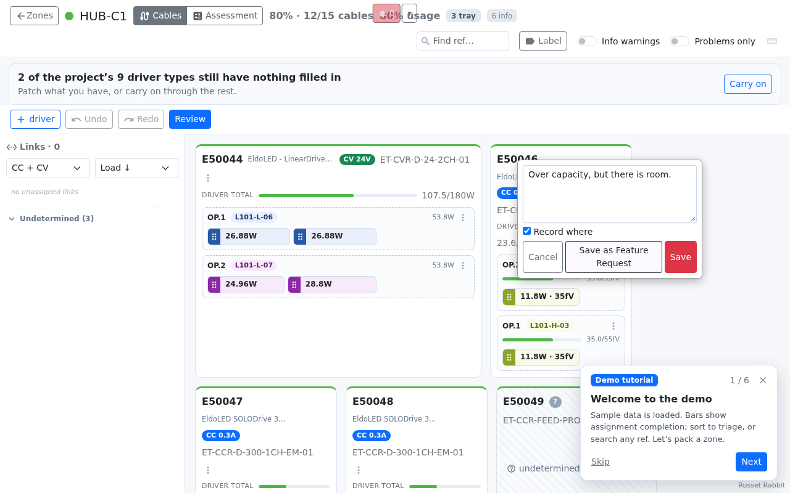
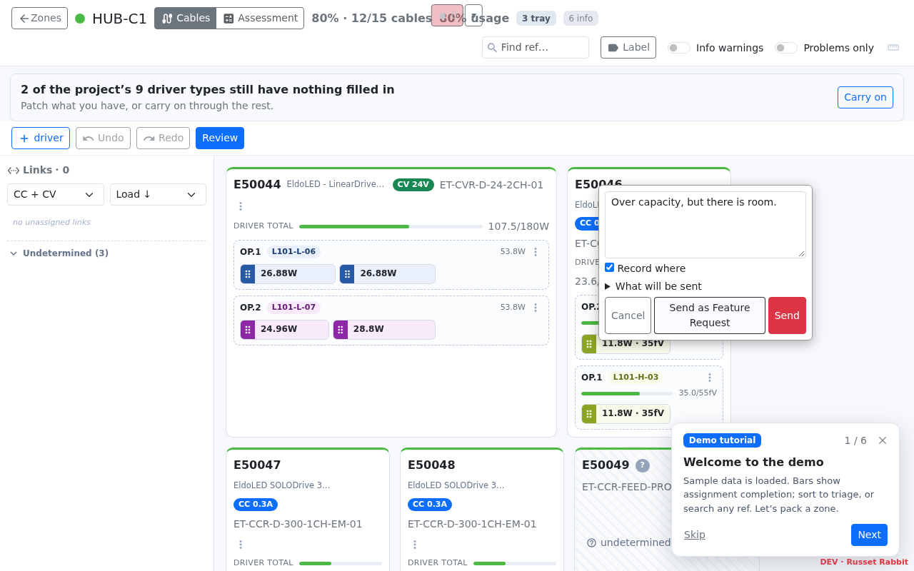

# The companion

The same build runs in two places. On GitHub Pages it is complete on its own. Self-hosted, a
**companion** at `./companion/` answers too, and the bug reporter sends reports instead of only
saving them. The app finds out which by fetching `companion/capabilities` once (`src/companion.js`).
A 404, an HTML page or no answer at all means there is no companion, so nothing changes.

| | Pages | Self-hosted |
|---|---|---|
| `companion/capabilities` | 404 | `{"protocol":"dat-companion/1","features":["reports","opened","parts"]}` |
| Bug note buttons | Save | Send (the report is still kept locally) |
| Crash screen | Copy | Copy, plus **Send the report** (sends only on a click) |
| Driver parts | the static catalogue | the static catalogue, plus the shared one; a part can be shared from the type editor |

## What a report sends

`remoteReport()` in `src/bugReports.js` builds the report from allowlists. It never builds one by
removing fields from a fuller object, so a new field is never sent by default. **What will be sent**
in the note shows the exact JSON before the person sends it.

- **The row the report is about.** This is looked up in the model by ref, never read from the screen.
  It holds the Element IDs, type, loadings, and the proposed placement beside the baseline. For a
  driver, that also covers its nodes and the cables on them.
  An assessment row sends its PositionType, ControlGroup and loadings, but not its location.
- **The patch**, from the Report flag in Review changes: the cables moved (ref, from, to) and the
  types, drivers added and drivers deleted, as refs only.
- **The estimate line**, from "Calculation looks wrong" in an estimate's working: the type, count,
  quantity, limit, ControlGroup, row refs, the engine's working figures and the options. No locations.
- **Context.** Branch and set IDs, the hub, the mode and the overlay version.
- **The build.** Version, channel, build name and commit.
- **Where it happened.** Screen, hub and counts; the area and dialog names; up to ten refs; the
  times, screens and areas (`data-debug-id`) of the last clicks. Tag a new surface with a
  `data-debug-id` or a report from it says nothing about where it came from.

It never sends a CSV, the session, or any free text from the screen: no row text, no button
labels and no location names.

On Pages the same note offers only Save:

## Shared driver parts

`GET companion/parts` returns the shared catalogue for the channel (prod and dev are separate);
`POST companion/parts` with `{part}` adds one and returns the new list. datajoin stores them in
`dat_parts`: one `observed` row per name, the latest write wins, and a `confirmed` row (set by hand)
outranks it. Each row keeps a hash of the sender's IP so one source can be purged.

A part is datasheet ratings only, never design data: name, code, aliases (matched as substrings, no
regex is ever shared), CC/CV, kind, control type, the numeric ratings. datajoin validates every
field against fixed ranges and drops anything else.

In the app (`setSharedParts` in `src/catalogue.js`):

- The static catalogue always wins. A shared part whose name matches a static one is an
  **amendment**: the editor offers its value beside the datasheet's ("shared: 33"), never in its place.
- A shared part only fills blanks, never overwrites (`canReplace` is false), and a type filled from
  one has origin **shared**, listed on its own in Review changes so it is checked before the patch.
- **Share as a catalogue part…** / **Suggest a correction to X…** sits under the type editor;
  "Describe it yourself" in New type reaches it when no part matches.

## Build names

`vite.config.js` stamps every HTML entry with `build-commit`, `build-tree` and `build-name`. The
build name is an adjective and an animal chosen from the tree hash, the same scheme the PS&R tool
uses. A dev build and the prod build it ships as therefore share one name. The badge sits
bottom-right, and on the dev channel (`APP_CHANNEL=dev`) it reads **DEV · name** in red:

